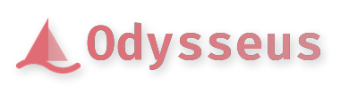

  

  A customized, self-hosted AI workspace optimized for Windows, local LLMs, and reliable agent workflows.

About

This is my personal fork of Odysseus, focused on improving Windows compatibility, local AI integration, web research, and agent reliability while preserving the original project's features.

Features & Improvements

Windows Support — Improved compatibility, execution logging, and PowerShell startup automation.

Local AI Models — Integration with llama.cpp, GGUF models, and GPU acceleration.

Web Research — Improved web search accessibility and research workflows.

Agent Reliability — Better handling of recoverable tool failures and HTTP errors.

HTTPS Compatibility — Improved SSL certificate handling for Python environments.

Quick Start

Clone the repository:

git clone https://github.com/AndresCandido/odysseus.git
cd odysseus

Launch Odysseus on Windows:

.\launch-windows.ps1

Open http://127.0.0.1:7000 in your browser.

Credits & License

Based on Odysseus by its original developers and contributors.

