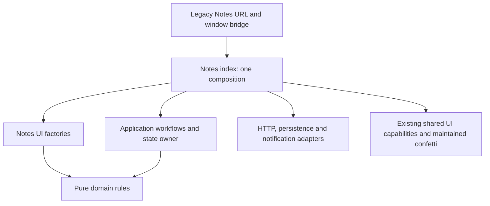

# Notes reference decomposition

Implementation started: 2026-10-13. Final validation: 2026-10-14.
Foundation: [PR #6701](https://github.com/odysseus-dev/odysseus/pull/6701),
`1cc56cb9d78f3e2399d1d61155b71d771a17b85b`. Branch was safely updated via
non-destructive fast-forward to latest official `upstream/dev` at
`86b886c611338282af6d4a717246ea4e256f58df`, incorporating PRs #6704 and #6693.
Neither changed a file in the Notes diff. The independent AGY audit returned
CONDITIONAL PASS; all pre-publication corrective actions (issue template conformance,
PR template conformance, visual evidence paths, and em-dash removal) have been completed.

The entire implementation belongs to one Notes PR. N0 through N6 are internal
checkpoints, not separate branches, commits or PRs. The [validation receipts](notes-validation.md),
[module inventory](notes-module-inventory.md) and [changed-file inventory](notes-changed-files.md)
accompany this case study.

## Responsibility map and size

The original `static/js/notes.js` contained 5,471 lines. It mixed mutable Notes
data, view preferences, selection, undo, CRUD, date calculations, reminders,
browser persistence, editor autosave, rendering, canvas tools and window management.
Its import evaluated storage preferences and scheduled reminder initialization.

| Original responsibility | Maintained owner |
| --- | --- |
| Completion, tags, recurrence, date labels and serialization | `domain/recurrence.js`, `domain/noteRules.js` |
| Notes data and selection/filter/editing state | `application/state.js`, instantiated once in `index.js` |
| CRUD, undo and fetch completion ordering | `application/workflows.js`, `cardOperations.js`, `deletion.js` |
| Checklist mutations and rollback | `application/checklistOperations.js` |
| Editor optimistic submission and recovery | `application/submission.js` |
| Serialized autosave and synchronous backup | `application/drafts.js`; form collection in `ui/draftEditor.js` |
| Filtering, searching and ordering | `application/queries.js`; controls in `ui/filters.js` and `toolbar.js` |
| Selected-note attachment and bulk requests | `application/selection.js`; controls in `ui/selection.js` |
| Existing agent-solve workflow | `application/agentActions.js`, through supplied HTTP/session ports |
| HTTP, persistence and browser notifications | `infrastructure/http.js`, `storage.js`, `notifications.js` |
| Background scheduler and delivery decisions | `application/reminders.js` |
| Panel mounting, closing, keyboard handling and navigation | `ui/panel.js` |
| Docking, fullscreen bounds and stacking | `ui/windowLayout.js`, using existing shared capabilities |
| Cards, card gestures, quick add and masonry | `ui/cardRendering.js`, `cardInteractions.js`, `cardChecklist.js`, `cardReorder.js`, `quickAdd.js`, `layout.js` |
| Editor types, colors, reminders and checklists | `ui/editor.js`, `colors.js`, `reminderPicker.js`, `checklist.js` |
| Drawing, local drawing undo and PNG upload | `ui/drawing.js` |
| Mobile reader/editor and reorder gestures | `ui/mobileEditor.js`, `mobileReorder.js`, `checklistReorder.js` |
| Clipboard, safe rendering and reminder display | `ui/clipboard.js`, `text.js`, `reminderDisplay.js` |
| Owned document/window listener disposal | `ui/lifecycle.js`, with panel and observer disposal callbacks |
| Composition and supported exports | `index.js`; five-line legacy facade at `static/js/notes.js` |

The feature has 41 maintained modules: two domain, eleven application, three
infrastructure, twenty-four UI and one index. Source is counted once, excluding
byte-identical deployment copies. Domain has 356 lines, application 826,
infrastructure 112, UI 4,628, and composition 518: 6,440 maintained feature lines.
The module inventory records final per-file counts. The legacy entry shrank
from 5,471 to five lines. Interfaces and explicit composition increase the total
source size; reducing total lines was not the architectural objective.

One 28-line stateless confetti renderer also moved to `shared/ui/confetti.js`.
Notes and Compare both use it. Compare retains its existing `spawnConfetti` export,
which is the same function as the shared export. This removes Notes' import of
Compare's private voting implementation without migrating Compare itself.

## Dependency graph and composition

Application modules receive adapters and feedback operations as arguments. They
do not import browser infrastructure or DOM views. Pure domain modules receive
the clock at the original read sites. UI consumes a read-only state view and
application operations. Composition supplies callbacks between views and workflows;
modules do not import the coordinator back. F1 rejects maintained-source cycles.

There are nine exact legacy-import exceptions, all on the Notes index. They bridge
the existing UI, modal, color-picker, drag, tile, dock, stacking, Escape and tour-hint
capabilities at their existing URLs. Their removal condition is migration of the
corresponding shared responsibility to maintained source with its identity and
lifecycle contract verified. No new feature imports another feature's private internals.

## State and asynchronous ownership

`createNotesState` is called once. It owns the Notes collection, selection IDs,
editing ID, search, filters, archive/view flags, loading and dismissed-reminder time.
Neither the facade nor reminders create a second collection. The public feature API
does not expose this store.

Internal views are read-only live views rather than detached snapshots. This choice
preserves captured note identity: an existing asynchronous rollback still acts on
the same captured note. Array/object writes and selection mutations must use the
state owner's operations. Workflow-local undo queues and serialized draft promises,
and UI-local canvas undo/gesture state, are not competing Notes stores.

Fetches retain the original last-completion behavior. An earlier request that
finishes later can overwrite a later request's result. Tests pin this behavior;
generation guards would be a separate behavioral change. Submission also retains
the original first-temporary-note replacement rule. Multiple simultaneous creations
need a separately reviewed correlation fix, not a silent change during extraction.

Archive, unarchive, pin, item edit/remove/add, delete and undo preserve their original
optimistic ordering and rollback. Animation callbacks remain view-owned. Drawing
save keeps the existing button guard around its asynchronous PNG upload. Draft writes
are serialized per editor; a completed older save cannot clear a newer local draft.

Reminder scans still use the originally loaded Notes collection, not a second
all-active cache. An archived-only collection or a failure-cleared list can defer
active reminders until an active refresh/reopen. The timer remains alive when the
panel closes, but extraction does not redesign this inherited data-availability
limitation. Review such a change separately from scheduler/state ownership.

## Public compatibility

The import URL remains `/static/js/notes.js?v=20260911notesselectioncancel1`.
App, Chat stream updates, Chat note links and Documents continue using their existing
imports. Calendar and Documents retain their window bridge calls. HTML and app
bootstrap code are unchanged. The service worker retains the exact legacy entry.

The legacy namespace still exports `openPanel`, `closePanel`, `togglePanel`,
`isPanelOpen`, `openNote`, `newNote`, `refreshDueBadge`, `dismissFiredReminderDot`,
`openNotes`, `closeNotes`, `isNotesOpen`, and `default`.
The default object's ten methods are unchanged; `dismissFiredReminderDot` remains
named-only. Aliases refer to the same functions, including those on the default
object. `openNote` and `refreshDueBadge` remain async; function arities are pinned.

`window.notesModule` is exactly the default controller. The canonical unversioned
feature index and both tested legacy entry URLs share the same controller and
operations. The default object retains its existing mutability. A different legacy
URL has its own ESM namespace, as native ESM requires, but creates no second store
or scheduler because it forwards to the same canonical index.

The canonical index additionally exports `startNotesBackground` for explicit
activation. The compatibility facade invokes it once through an idempotent start
operation. Existing consumers need no change. Remove the facade only after every
consumer, global bridge, bootstrap and offline reference has migrated together.

## Protected selected Notes/Todos integration

The sender dispatches `odysseus:notes-context-selected` on `window` with
`{ noteIds, accepted: false }`. Dispatch and acknowledgement remain synchronous.
Chat owns acceptance, its session/pending selection, the context indicator and
the `selected_note_ids` send payload. Notes exits selection only after acceptance.
Rejected selections stay selected and display the existing feedback.

No Chat internals were imported or changed. Existing session lifecycle events still
transfer a pending selection on materialization, restore selections on chat switches,
and reset them for a new chat. Backend ID validation and owner filtering remain
authoritative. Unit/backend tests cover these contracts; the real authenticated
browser probe verifies rejection, pending-chat acceptance, the actual indicator and
new-chat reset. Live model execution is not part of that probe.

## Persistence and HTTP contracts

| Key | Preserved format |
| --- | --- |
| `odysseus-notes-view` | `list` or `grid` |
| `odysseus-notes-labels-collapsed` | `1` or `0` |
| `odysseus-notes-first-open-hint-v1` | Existing first-open marker |
| `odysseus-notes-reminder-fired` | JSON array of IDs |
| `odysseus-notes-reminder-glowed` | JSON array of IDs |
| `odysseus-notes-reminder-pending-highlight` | JSON array of IDs |
| `odysseus-notes-reminder-active-highlight` | JSON array of IDs |
| `odysseus-notes-reminder-dismissed-at` | Decimal millisecond timestamp |
| `odysseus-note-draft-<id>` and `odysseus-note-draft-__new__` | Existing JSON draft fields and `_ts` |

CRUD, reorder, upload, reminder firing, default-chat lookup, session creation and
chat-stream requests keep their URLs, methods, credentials, payloads and error
interpretation. Uploads retain `files` and optional `gallery_id` multipart fields.
The agent-solve stream still disables `manage_notes` and drains without switching
the user's chat. No backend implementation changed.

Storage backup failures still warn once; failed network saves keep recoverable
drafts, including intentionally empty text. Draft JSON does not serialize a canvas
bitmap. A drawing remains ephemeral until its explicit PNG upload, as before.

## Lifecycle scopes and explicit corrections

| Scope | Owner and disposal |
| --- | --- |
| Browser page | One reminder startup timeout and interval; page termination ends them. The reminder factory also has explicit disposal. |
| Open panel | Capture/bubble keyboard handlers, reorder listeners and masonry observer; both close paths dispose them. |
| Editor/canvas | Local DOM handlers and draft workflow; drawing's window listener is released when its canvas detaches or the panel closes. |
| Mobile editor/gesture | Overlay and document touch handlers; owner replacement and panel disposal remove handlers and reset registration flags. |
| Menus/hints | Notes portals close with the panel; shared dismiss functions unregister their Escape/tour lifetimes. |
| File picker | Existing completion or 30-second cleanup owns the temporary input. |

Two implementation corrections follow the user's explicit lifecycle requirements.
The original close paths canceled the supposedly background reminder interval.
The new page-owned interval survives closing/minimizing Notes, while retaining the
3-second startup delay, 30-second period and immediate first check. Closing a panel
also releases owned observers/listeners, pending hold timers, active Notes gestures
and portals; late panel fetch callbacks do
not recreate UI on a detached panel. Network completion/state ordering is preserved.

Shared drag/window utilities continue owning their own active-gesture handlers.
They were not moved into Notes. Idle open/close and editor replacement are verified;
every possible interleaving with an active shared window drag was not tested.

## Source and deployment

Every maintained source is registered in `frontend/modules.json` and copied without
rewriting imports. Notes sources map to `static/js/features/notes/` at the same
relative paths. Shared confetti maps to `static/js/shared/ui/confetti.js`.
Repository-owned LF attributes and byte parity cover all 43 maintained modules,
including the unchanged F1 proof. The legacy facade is an authored compatibility
entry, not a second implementation.

All new outputs join exact service-worker precache arrays. A real offline test also
found eight previously missing exact legacy URLs in the Notes graph; those entries
are now included. The eager Notes graph has 57 exact runtime URLs. Cache naming
follows the repository's `odysseus-v659-notes-reference` convention. Root offline
reload remains outside certification because the existing worker scope is `/static/`.

Python startup and Docker serve the committed static graph without maintained
source or frontend tooling. The publisher is a development check/copy operation,
not a runtime compiler or an atomic deployment system.

## Checkpoints, rollback and lessons

[Checkpoint receipts](notes-validation.md#internal-checkpoints) record the actual
checks and local snapshot hashes. These intermediate snapshots are engineering
evidence, not standalone release artifacts. N5 includes bounded editor, cards,
checklist, drawing, mobile, toolbar and window reviews on the same branch.

The N3 mechanical state rewrite initially confused canvas-local and feature undo
bindings. The N5 drawing test found it; the canvas binding was restored and the
same drawing/undo interaction was replayed against the original implementation.
Use scope-aware transformations and test each stateful UI responsibility before
accepting a broad rewrite. Source parsing alone does not prove semantic equivalence.

For rollback, reconstruct the prior complete artifact from its revision/snapshot
in a fresh temporary directory, run parity/graph/behavior checks there, then publish
the matching static graph and service worker as a unit through the authorized
release process. Restore the whole facade/source/output/manifest set, not just
`notes.js`. No schema or storage-key migration needs reversal. Do not reset a dirty
worktree or delete unrelated outputs. The validation report gives a non-destructive
snapshot reproduction recipe.

For the next maintainer:

1. Start with the module inventory and the state/workflow contracts, then reproduce
   the focused tests, offline test and isolated native browser probe.
2. Review the explicit timer/lifecycle corrections separately from unchanged
   business rules. Inspect both maintained source and byte-identical deployment.
3. Resolve or track the reproduced upstream CI failures and the open PR overlaps
   before authorizing publication. Create/link the dedicated issue, then publish
   exactly one Notes PR targeting official `dev`.
4. Record the integrated revision and independent recipient reproduction to complete
   H. The designated maintainer can then apply this method to future features.

For Calendar, Documents, Email and later monoliths, characterize actual exports,
URL identities, state writers, clock reads, I/O and lifecycle first. Extract pure
rules, then adapters, then a single state owner/workflows. Use explicit callback
ports to break coordinator cycles. Split UI by interactions and resource lifetime,
not by arbitrary line ranges. Transfer source/output ownership and offline URLs
with each boundary, and preserve source-sensitive assertions at their new owner.
Those feature migrations are not part of this implementation.
