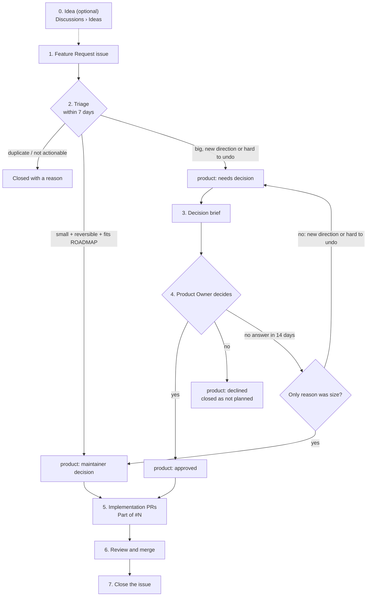

# Product and feature proposals

Pewds ([@pewdiepie-archdaemon](https://github.com/pewdiepie-archdaemon)) is the Product Owner for Odysseus and has final authority over product direction. Maintainers own technical feasibility, implementation, and safety.

This page has two parts: **which changes need product approval**, and **the workflow every feature proposal follows**, from issue to merged PR. The terms in bold are defined in [Definitions](#definitions); when a case is unclear, the definitions decide, not intuition.

## Which changes require product approval?

**Product Owner approval before implementation:** features that are **big**, set a **new direction**, or are **hard to undo**.

**No separate product approval by default:** bug fixes, security fixes, maintenance, tests, CI, documentation, internal refactors, and features that are **small**, **reversible**, and **fit ROADMAP**.

Maintainers may make those smaller product decisions. Pewds can ask for changes or a rollback; the maintainer who decided owns the rollback or recovery.

### Urgent security and reliability fixes

Urgent fixes or containment may proceed without prior product approval, even if behavior temporarily changes. Keep the change to what stops the immediate problem, notify Pewds promptly, and record the reason and rollback or recovery plan. Agree on any lasting product-direction change with Pewds afterwards. Normal high-risk review and repository checks still apply.

## Product Owner initiated

```text
Product Owner proposal or implementation
    -> technical feasibility
    -> plan and implementation
    -> risk-based review and validation
```

A Product Owner proposal is already product-approved; it is not automatically technically approved or exempt from high-risk review.

## Feature proposal workflow

Every community or maintainer feature proposal follows these steps. The issue is the record at every step: labels show where a proposal stands, and comments hold the decisions.



### Step 0 — Idea (optional)

Half-formed ideas go to [Discussions › Ideas](https://github.com/odysseus-dev/odysseus/discussions/categories/ideas) to gauge interest. Nothing is decided there. A proposal is ready for step 1 when it is **actionable**.

### Step 1 — Feature Request issue

**Who:** the proposer.

Open a [Feature Request](https://github.com/odysseus-dev/odysseus/issues/new?template=feature_request.yml) after checking [ROADMAP.md](../../ROADMAP.md) and open issues. Besides the required fields, the form asks three optional questions that make triage faster:

- whether the proposer thinks it is big, a new direction, or hard to undo;
- the yes/no questions they want the Product Owner to answer;
- screenshots, a recording, or a demo branch.

A proposal with several independent parts may be one issue, provided each part is listed separately so it can be decided separately.

### Step 2 — Triage

**Who:** a **triager**. **When:** within 7 days of the issue being opened.

The triager does one of three things and records why in a comment:

| Outcome | When | Label | Next |
|---|---|---|---|
| Close | **Duplicate** or not **actionable** | — (closed as duplicate or not planned, with a link) | — |
| Maintainer decision | **Small** *and* **reversible** *and* **fits ROADMAP** | `product: maintainer decision` | Step 5 |
| Needs the Product Owner | **Big**, *or* **new direction**, *or* **hard to undo** | `product: needs decision` | Step 3 |

The triage comment names the ROADMAP line the proposal fits, or says that it fits none, and which of big / new direction / hard to undo applies. When the triager is unsure, the proposal goes to the Product Owner.

### Step 3 — Decision brief

**Who:** the proposer writes it; the triager checks it is complete before the clock starts.

The brief goes at the top of the issue body (edit the issue, or post it as the first comment and link it from the body) and contains:

1. **Summary:** what changes for users, in three to five lines.
2. **Questions:** the exact yes/no questions, one per independent part.
3. **Evidence:** screenshots or a recording for anything that renders; a demo branch if one exists.
4. **What cannot be undone:** migrations, deleted data, changed contracts, or "nothing".
5. **For big designs only:** architecture, migration and rollback, and the planned PR slices. A long design may live in a proposal document under `/design` and be linked from the brief.

When the brief is complete, the triager mentions the Product Owner on the issue. This is **day 0** for the timeout.

### Step 4 — Product Owner decision

**Who:** the Product Owner. **When:** on the issue at any time, or at the next **queue review**.

| Answer | Label | Recorded as |
|---|---|---|
| Yes, possibly with conditions | `product: approved` | A **recorded decision** listing any conditions |
| No | `product: declined` | A recorded decision; the issue is closed as not planned |
| A question | stays `product: needs decision` | The clock pauses until the proposer answers, then restarts at day 0 |
| Different answers per part | the label for the approved part(s) | The recorded decision lists each part and its answer |

A decision given outside GitHub (Matrix, a call) counts once a maintainer has recorded it on the issue. A declined feature can be maintained in a contributor's fork, and the issue can be reopened only with **materially new** information.

#### When there is no answer: lazy consensus

| Day | What happens |
|---|---|
| 0 | Brief complete; Product Owner mentioned on the issue |
| 7 | One reminder from a maintainer, and the issue is put on the next queue review |
| 14 | If there has been no **objection**: |

- If the **only** reason the proposal needed the Product Owner was that it is **big** — it is **reversible** and **fits ROADMAP** — a maintainer may decide. They record "decided by lazy consensus on YYYY-MM-DD", apply `product: maintainer decision`, and own any rollback Pewds later asks for.
- If it is a **new direction** or **hard to undo**, it keeps waiting. Silence never approves a one-way change or a change of direction. It is raised at each queue review.
- A proposal still waiting after **90 days** is closed as not planned with a comment saying it expired without a decision. It can be reopened by anyone with the same brief.

### Step 5 — Implementation

**Who:** the proposer or any contributor.

Feature PRs link the issue with `Part of #N` (or `Fixes #N` for the last slice) and stay within what was decided. A maintainer does not merge a feature PR whose issue carries neither `product: approved` nor `product: maintainer decision`, and checks any conditions in the recorded decision.

If the work grows beyond what was decided — a new part, or a part that becomes hard to undo — that part goes back to step 2.

A maintainer's own small, reversible feature that fits ROADMAP may skip the separate issue: the PR description states why it qualifies, and the PR is the record.

### Step 6 — Review and merge

Unchanged: [changes and review](changes-and-review.md). Product approval is not technical approval; high-risk changes still need an independent qualified review.

### Step 7 — Close

The issue is closed when the last PR lands. If the feature was a ROADMAP item, the same PR or a follow-up updates ROADMAP.md.

## Labels

| Label | Meaning | Applied by |
|---|---|---|
| `product: needs decision` | Waiting for the Product Owner | Triager |
| `product: approved` | The Product Owner said yes (see the recorded decision for scope and conditions) | Product Owner or the maintainer recording the decision |
| `product: maintainer decision` | Small, reversible and on ROADMAP, or decided by lazy consensus | Triager, or the maintainer applying lazy consensus |
| `product: declined` | The Product Owner said no | Product Owner or the maintainer recording the decision |

Only maintainers and the Product Owner set or change these labels. Exactly one of them is on a triaged feature issue at any time.

## Definitions

**Feature.** A change that adds or alters user-visible behavior, a setting, or a public contract (HTTP API, MCP tool, plugin interface, file format). Restoring documented or clearly intended behavior is a bug fix, not a feature.

**Small.** All of the following are true:

- it ships as one PR of ordinary size — as a guide, no more than about 600 changed lines excluding tests, generated files and lockfiles;
- it touches one area of the app;
- it adds an option or a capability without changing what existing users see or get by default;
- it adds no new dependency, service, or background process.

Anything else is **big**.

**Reversible.** Reverting the PR(s) fully restores the previous state for every user, with nothing left behind: no data migrated, rewritten or deleted; no stored format that other code or users now depend on; no public contract that integrations have started to use; no security boundary moved. If any of those is not true, the change is **hard to undo**.

**Hard to undo.** Not reversible. Typical cases: data migrations, deleting or purging data, new persisted formats, new or changed authentication, permission or sharing models, and removing or renaming a public API, MCP tool, setting or file location.

**New direction.** The change takes Odysseus somewhere it has not committed to. Any of:

- a new top-level area of the app (a new panel, tab or module);
- multi-user or collaboration features where the app was single-user;
- data or requests leaving the user's machine by default, including telemetry and new external services;
- dropping or adding a supported platform, install method or model backend;
- anything listed under "Not The Focus Right Now" in ROADMAP.md;
- reversing a previous Product Owner decision.

**Fits ROADMAP.** The triager can point to a specific ROADMAP.md item that the proposal implements or directly extends, and the proposal is not listed under "Not The Focus Right Now". "It is in the same area as an item" is not enough.

**Actionable.** The issue states a concrete problem and a concrete change in behavior, specific enough to write acceptance criteria from.

**Duplicate.** Same user-facing outcome as an open issue or open PR, or a request for a ROADMAP item that adds nothing to it. Close it with a link, and move any new information to the original. A proposal that offers to *implement* a ROADMAP item, with a concrete design, is not a duplicate: it is triaged normally and usually **fits ROADMAP**.

**Triager.** Any maintainer other than the proposer. A maintainer's own proposal is triaged by another maintainer.

**Objection.** A comment on the issue — or one recorded there from another channel — by the Product Owner or a maintainer, asking to stop, wait, or change the scope. A maintainer's objection stops lazy consensus for that proposal; it then waits for the Product Owner like a new direction does. Questions and suggestions that do not ask to stop are not objections.

**Recorded decision.** A comment on the issue that states the decision, who made it, the date, where it was made if not on GitHub, the parts it covers, and any conditions — together with the matching label change.

**Queue review.** Every 14 days, a maintainer brings the [`product: needs decision` list](https://github.com/odysseus-dev/odysseus/issues?q=is%3Aissue+is%3Aopen+label%3A%22product%3A+needs+decision%22) to the Product Owner and records each answer on its issue. The maintainer who runs it is agreed among maintainers and noted here: *to be decided*.

**Days.** Calendar days, counted from the timestamp of the event on the issue (label applied, brief completed, reminder posted).

**Materially new.** Information the original decision did not have: a different design, new evidence of demand, or a changed ROADMAP.

## Decision boundaries

The Product Owner decides **what belongs in Odysseus**. Maintainers decide **how approved work is built safely and maintainably**.

A rejected or out-of-scope feature can be maintained independently in a contributor's fork.

If the Product Owner is unavailable, work that needs product approval follows the timeout above. It never proceeds on silence when it is a new direction or hard to undo. Smaller decisions and urgent fixes follow the rules above.
