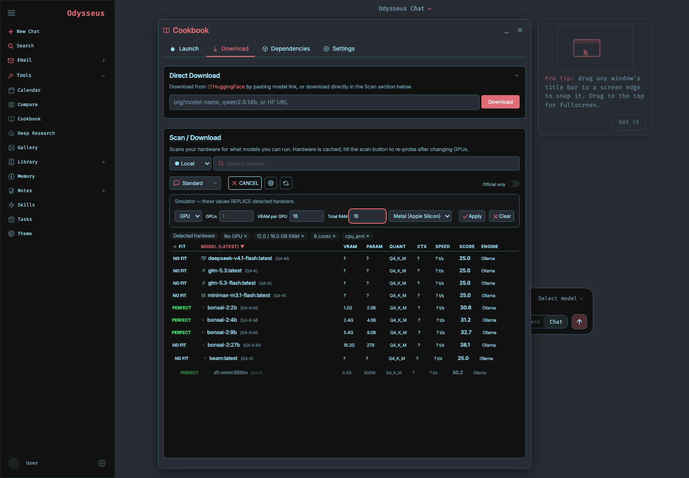
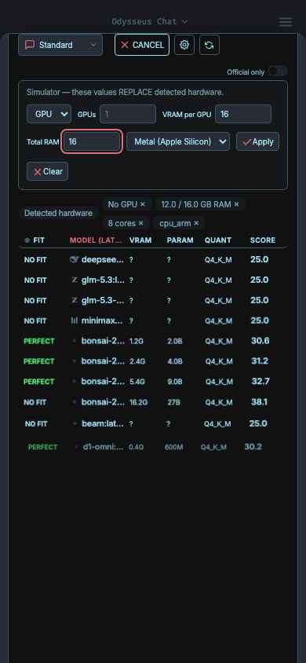
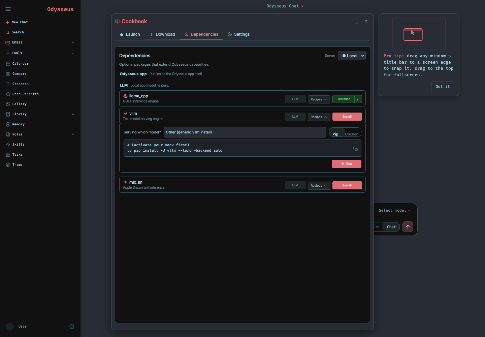
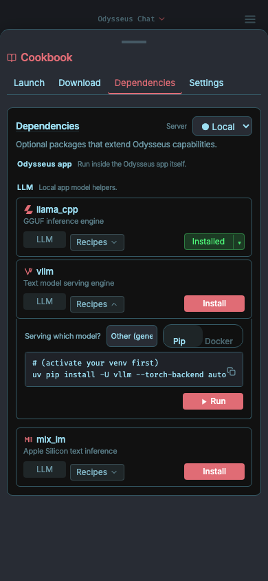
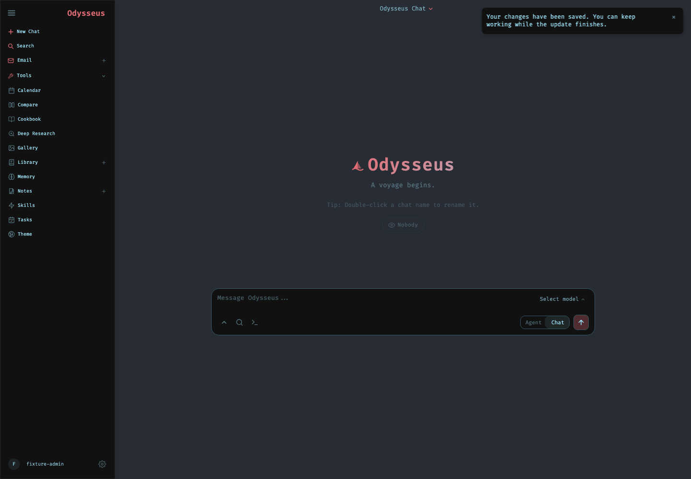
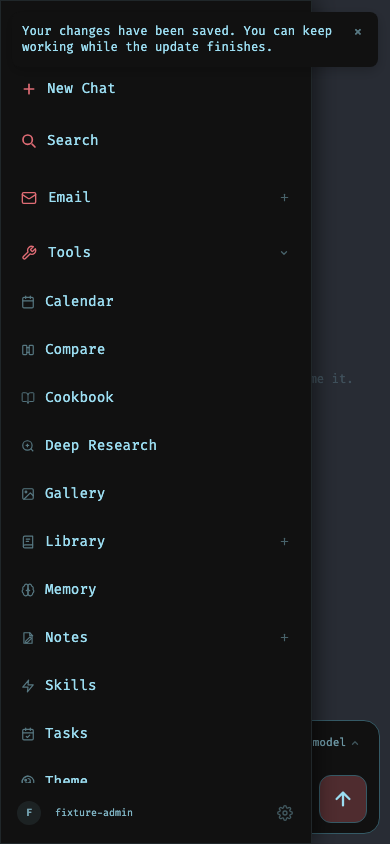

# Issue-fix visual verification

Captured from a disposable local Odysseus application on 22 October 2026. Desktop viewport: 1440 × 1000. Mobile viewport: 390 × 844.

Cookbook screenshots use deterministic package and hardware responses with the production UI. Toast screenshots use an authenticated fixture account. No live model or dependency-install task was executed.

| Surface | Desktop | Mobile |
| --- | --- | --- |
| Cookbook hardware |  |  |
| Cookbook recipes |  |  |
| Toast |  |  |

The behavioral tests separately cover chat timeout handling, attachment vision-label updates, reasoning removal from TTS, saved speech settings, recipe controls, and recipe request validation.
