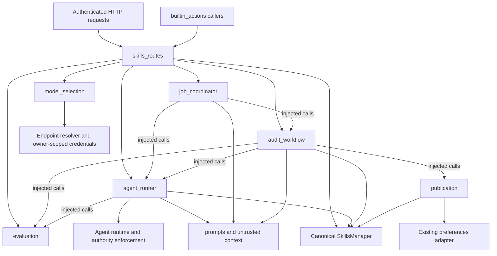

# Skills evaluation and audit architecture

The Skills backend separates HTTP transport, model evaluation, agent execution,
audit orchestration and publication policy. `services/skills/` coordinates those
responsibilities; `services/memory/skills.py` remains the canonical persistence
and lifecycle owner. The extraction preserves the existing HTTP and Python
contracts. [PR #6711](https://github.com/odysseus-dev/odysseus/pull/6711) tracks
this boundary change under [issue #6710](https://github.com/odysseus-dev/odysseus/issues/6710).

## Responsibilities and dependency boundaries

| Module | Responsibility |
| --- | --- |
| `routes/skills_routes.py` | FastAPI request models, endpoint declarations, authentication, ownership, HTTP errors, exact approval validation and Python compatibility bindings |
| `services/skills/job_coordinator.py` | Transient job creation, continuation after approval validation, candidate selection, public polling projections and cancellation requests |
| `services/skills/agent_runner.py` | Manual execution, audit arms, agent loop integration, transcripts, authority propagation, approval pauses and same-task stream closure |
| `services/skills/audit_workflow.py` | Per-skill audit sequencing, self-edit retries, teacher escalation, sequential batches and scheduled execution |
| `services/skills/evaluation.py` | Model grading, verdict parsing, necessity and retrieval checks, efficiency fields and markdown improvement generation |
| `services/skills/publication.py` | Confidence and publishing policy, duplicate rules, batch finalization and markdown updates through SkillsManager |
| `services/skills/model_selection.py` | Owner-scoped worker/teacher resolution, utility fallback, endpoint selection and credential lookup |
| `services/skills/prompts.py` | Shared task construction and explicitly untrusted skill context |
| `services/skills/dependencies.py` | Frozen `AuditDependencies` containing callable bindings and transient registry references |
| `services/memory/skills.py` | Canonical skill identity, owner isolation, durable storage, indexing, retrieval and lifecycle state |

The package initializer identifies the domain without adding a service facade.
Evaluation does not schedule jobs or persist skills. Publication computes policy
and applies updates through the supplied SkillsManager. Services do not import
`routes.skills_routes`. The existing preferences adapter in `publication.py`
still imports `routes.prefs_routes`; moving that adapter is a separate change.



Arrows include injected calls, rather than only Python imports. The workflow
imports `SkillAuditUnavailable` from the runner. Route wrappers construct
`AuditDependencies` on entry from the current route bindings, so existing
callers and monkeypatches reach the same collaborators without rebinding shared
service globals.

The manual test registry belongs to `agent_runner.py`; the audit registry belongs
to `audit_workflow.py`. Routes expose aliases to those dictionaries. Registries
hold process-local job state and are not durable skill stores. All durable
metadata, confidence, markdown and publication changes use SkillsManager.
Published-only retrieval and local exclusion of `remote-only` skills stay in
the manager/index boundary. Service loggers use their module names; the route
module retains its own logger. Root handlers supply the existing log output.

## Execution and publication lifecycle

1. The HTTP handler authenticates the caller, verifies ownership and validates
   the request. Manual model choices retain registered-endpoint validation and
   owner-scoped credential lookup.
2. Job coordination creates the owner-keyed transient record and launches the
   execution coroutine. Replacing a manual test retires its pending approval.
   Polling exposes only the existing public fields, excluding credentials,
   private transcripts, continuation state and asyncio tasks.
3. The runner uses the originating request authority or the consumed sealed
   approval authority. It captures the transcript and closes the async stream
   with `aclosing` inside the task that opened it, including early approval
   pauses, cancellation and exceptions.
4. Manual approval pauses return to the HTTP validation boundary. Continuation
   reconstructs context from the original untrusted skill and accumulated
   untrusted transcript. Manual completion records audit metadata and adjusts
   confidence (pass .95, needs_work .6, fail .4) without publishing.
5. An automated audit checks deterministic duplicates, advisory necessity and,
   when indicated, retrieval precision. It runs skill and no-skill arms on the
   same task, grades the result, then may self-edit and retry. An optional
   distinct teacher rewrites the skill; the worker performs the retry.
6. Publication applies owner preferences, confidence thresholds, necessity,
   utility and duplicate rules through SkillsManager. A normal sequential batch
   finalizes its processed results. Cancellation or infrastructure unavailability
   skips batch finalization and clears task/current state.

A clean audit pass sets confidence to .95, a self-edit pass to .85 and a teacher
rewrite pass to .8. Continued failure becomes draft at .35. Unknown and
inconclusive verdicts preserve publication state. Automatic publishing requires
an enabled owner policy, a passing verdict at or above the configured threshold,
and no necessity, worse-baseline or duplicate blocker. The default threshold is
.85; owner values are clamped to [0, 1]. Markdown edits pin the existing skill name
so usage and audit sidecars remain attached to the same identity.

Per-skill duplicate blocking and batch duplicate finalization have distinct
selection rules and must not be consolidated without a behavior proposal.
Batch finalization excludes builtins and binned records, changes only processed
skills, protects approval-required results, and bins duplicate losers. Duplicate
similarity uses the existing .38 threshold and name-suffix grouping.

Batches run sequentially per owner, retain current/done/results and timestamps,
and cap progress logs at 1,000 entries. Ordinary exceptions record inconclusive
skill audits. Infrastructure failures stop the batch without inventing a skill
verdict. Scheduled execution skips an active owner job, selects existing lifecycle
candidates by oldest audit, caps the batch (default eight), and marks model phases
as background work. These services retain the existing scheduling and
cancellation semantics.

## Security and approval invariants

HTTP authentication and owner verification remain at the transport boundary.
Manager reads and writes receive the owner. Ownerless builtins retain their
existing visibility; an authenticated user cannot access an ownerless ordinary
skill. Existing ownerless deployment behavior is preserved.

The `/test-approval` handler validates the pending job, approval ID, decision,
owner and empty session binding, then destructively consumes the sealed approval
with `allow_continuation=False` before calling the coordinator. Stale, mismatched
or reused approvals fail with 409. The consumed grant authorizes only its exact
action. Services do not manufacture approval authority or relax process identity,
workspace confinement or request-authority enforcement in the agent runtime.

Skill markdown and resumed transcripts remain explicitly untrusted context,
never trusted system instructions. Audit arms suppress saved skill injection.
Unattended runs deny encountered approval records instead of leaving reusable
grants. An initial approval-required audit result preserves the skill's publication
and confidence and directs the user to manual approval. Retry handling has an
inherited gap: an approval pause after a rewrite can still lead to demotion.
Same-task stream closure preserves the originating ContextVar cleanup, but manual
cancellation can retain private continuation state. These are separate hardening
items, not guarantees supplied by the extraction.

## Model selection and evaluation

Audit resolution uses an explicit endpoint/model pair when supplied, looking up
credentials among enabled owner-visible endpoints. A model-only choice uses the
existing owner-scoped model resolver. Otherwise it resolves the utility model,
including the resolver's default behavior, then takes the first configured
utility fallback if the primary result is incomplete. A missing worker raises
`ValueError`. Served-model normalization keeps an exact match, then a basename
match, then the first served ID; discovery exceptions keep the resolved choice.

An enabled teacher resolves separately with the same owner. Its credentials are
not borrowed from the worker. Teacher resolution failure logs the existing warning
and leaves the teacher absent. Manual tests retain their HTTP endpoint validation
and registered fallback credentials.

Owner reasoning effort is resolved for each evaluation or rewrite call. Workload
flags, credentials, retries, prompts and permissive parsing remain unchanged:

| Phase | Token budget | Timeout in seconds |
| --- | --- | --- |
| Run review, up to two attempts | 32768 | 180 |
| Necessity | 8192 | 120 |
| Retrieval precision | 4096 | 90 |
| Markdown improvement | 16384 | 180 |

Review parsing retains think-block stripping, trailing-comma recovery, last
usable verdict selection, prose fallback, bounded fields and unknown outcomes.
These model outputs are advisory and do not grant execution authority.

## Public HTTP contract

All paths below have prefix `/api/skills`. Successful status defaults to 200.
Request models and endpoint declaration order remain fixed. A frozen
OpenAPI and declaration-order fixture records
the baseline contract independently of the extracted implementation.

| Method and suffix | Successful response | Authorization and errors |
| --- | --- | --- |
| GET empty | `skills,count` | Owner-filtered load |
| GET `/index` | `index,count` | Owner-scoped eligible index |
| GET `/slash-catalog` | `skills,count` | Owner-scoped index; sorted slash entries |
| GET `/builtin` | `builtin,count` and optional `error` | Existing shared capability text |
| GET `/builtin/{name}` | `name,text,default,is_overridden` | 404 missing tool; 500 import failure |
| PUT `/builtin/{name}` | `ok,name,is_overridden` | Admin; 404 unknown, 400 missing text |
| DELETE `/builtin/{name}` | `ok,name,is_overridden` | Admin |
| POST `/import-from-url` | `ok,skill,files` | Admin and current owner; 400 import, 502 HTTP, 500 other failure |
| POST `/add` | `ok,deduped,skill` | Current owner passed to manager; unchanged old/new request fields |
| POST `/{skill_id}/invoke` | `ok,type,name,command,message` | Eligible owner index only; 404 unavailable/source missing |
| GET `/{skill_id}` | Full skill dictionary | Owner load; 404 missing |
| GET `/{skill_id}/markdown` | `name,markdown` | Owner verification; 404 missing/source missing |
| POST `/{skill_id}/test` | `ok,status,skill,model` | Owner verification, HTTP request authority, registered fallback credentials; 400 missing/invalid model |
| POST `/{skill_id}/test-approval` | `ok,status,decision` | User approval request, owner verification, pending ID/owner/empty session match; 400 invalid body/decision, 409 stale/mismatch/consumed |
| GET `/{skill_id}/test-status` | `status` or `status,task,model,log,verdict,approval` | Owner-keyed lookup; server continuation/credentials omitted |
| POST `/audit-all` | `ok,status,total` plus running `done,model` or empty `results,log` | Owner-keyed singleton; 400 model resolution |
| GET `/audit-all/status` | `status` or job progress/result/log/timestamps | Owner-keyed lookup; task and credentials omitted |
| POST `/audit-all/cancel` | `ok,status` | Owner-keyed lookup and cancellation |
| POST `/{skill_id}/markdown` | `ok,name` | Owner verification; 400 missing/parse, 404 missing, 500 update |
| PUT `/{skill_id}` | `ok` | Owner verification and scoped manager update; 404 missing |
| DELETE `/{skill_id}` | `ok` | Owner verification and scoped manager deletion; 404 missing |
| POST `/search` | `skills,query,count` | Owner-filtered input; 400 empty query |

Strict owner verification allows an ownerless builtin but denies an ownerless
ordinary skill for an authenticated user. The existing ownerless deployment
behavior remains. Global auth middleware is unchanged.

## Python compatibility and frozen contracts

`app.py` imports `setup_skills_routes`. `src/builtin_actions.py` uses the existing
route helpers and audit registry. Route aliases and wrappers preserve the original
28 inspectable interfaces, `SkillAuditUnavailable`, registry identity and patchable
collaborators. Lazy model/agent imports and route-level effort injection keep
existing offline test seams effective.

The task and message callbacks are bound through `AuditDependencies` at service
entry. Patches to route-level test tasks and test/baseline messages reach manual
execution, approval continuation, both audit arms, worker retries and scheduled
audits. The `_skill_baseline_task` compatibility alias delegates to the current
route test-task builder. Execution continues to reuse one task for both arms,
as in the original implementation; it does not independently derive a baseline
task through that alias.

`tests/fixtures/skills_api_baseline.json` records declaration order and structural
signatures captured from pre-extraction revision
`86b886c611338282af6d4a717246ea4e256f58df`. Signature records retain parameter
names, order, kinds, defaults, default factories and annotations, including
Pydantic constraint metadata. They compare typing origins and arguments instead
of Python-version-dependent annotation representations. The expanded records also
pin field validation aliases, alias priority, discriminators, `validate_default`,
rebuilt field annotations and model configuration. Field order remains visible
through the constructor parameter sequence. Only the known builtin factories
`list`, `tuple`, `dict`, `set` and `frozenset` are supported. Custom factories,
including closures and factories taking validated data, fail closed without being
executed. Unsupported metadata/configuration values also raise rather than using
unstable representations. This is a structural contract for supported interfaces,
not proof of behavioral equivalence for arbitrary validators or Python code.

The expanded fixture was derived again from the original revision above in a
detached scratch worktree, with the updated comparator copied in. Python 3.11
and 3.12 produced byte-identical snapshots. The previous parameter/return records,
all 28 interface names, all 22 endpoint declarations and the original OpenAPI
digest were checked unchanged before accepting the new field records.

`tests/fixtures/skills_openapi_baseline.json` is the same baseline's complete
Skills-router OpenAPI document, generated with a standalone FastAPI application.
Sorted keys, ASCII escaping, two-space indentation and a final newline make the
fixture deterministic. Tests require exact canonical equality and print a unified
diff on mismatch. The redundant digest field and assertions have been removed;
they provided no independent compatibility guarantee. The fixture pins model
schemas and constraints. CI reads committed fixtures and needs no Git history
for these tests. Baseline updates require an intentional compatibility decision, rather
than regenerating fixtures from a failing implementation.

The narrow `.gitleaks.toml` exception remains necessary for the historical public
digest in earlier fixture and documentation revisions. It applies to the exact digest,
the `generic-api-key` rule and the two named paths. Removing a current copy cannot
remove findings from published history. Keep the exception unless the pinned
full-history scan proves it unnecessary; do not rewrite history to remove it.
The checksum-verified 8.30.1 scan without this exception still reports both
historical copies in commit `a547c4d8`; retaining the exception passes the full
PR/dev history scan.
Reconsider it after squash merge only after verifying the resulting reachable
history with the pinned full-history scan.

The ReDoS source guard scans `services/skills/evaluation.py`, the canonical
evaluation parser module, as well as the retained route and memory-extractor
locations. Verdict regex runtime tests import the canonical module directly.
The source guard must reject reintroducing the lazy think-block expression;
the ordinary-input and adversarial-flood runtime tests remain in place. An isolated
source mutation reproduced the old guard's false green for the evaluation module.
The corrected guard rejected the vulnerable expression in each of the three
locations and passed again after restoring the temporary copies. The mutated
regex was never executed, and production parser behavior was not changed.

## Reproducible validation

From the repository root, use a virtual environment with `requirements-dev.txt`
installed and the repository's frontend dependencies available. The examples use
`.venv/bin/python`; repeat the contract tests with a Python 3.12 environment as
well as Python 3.11. Record interpreter/dependency versions with results.

```sh
.venv/bin/python -m pytest -q \
  tests/test_skills_audit_characterization.py tests/test_skills_audit_services.py
.venv/bin/python -m compileall -q app.py core routes src services scripts tests
.venv/bin/python -c 'import routes.skills_routes; import services.skills.agent_runner; import services.skills.audit_workflow'
.venv/bin/python scripts/build_frontend.py --check
node scripts/check_frontend.mjs
node --test tests/skillsApproval.test.mjs tests/frontendArchitecture.test.mjs
git diff --check
```

The focused Skills, authority and approval selection is reproducible with:

```sh
.venv/bin/python - <<'PYTHON'
from pathlib import Path
import subprocess
import sys

files = set()
for path in Path("tests").rglob("test_*.py"):
    text = path.read_text()
    if ("skill" in path.name or "approval" in path.name
        or "utility_reasoning" in path.name or "skills_routes" in text
        or "review_endpoint_credentials" in path.name):
        files.add(str(path))
files.update([
    "tests/test_request_authority.py",
    "tests/test_endpoint_registered_authority.py",
    "tests/test_redos_verdict_continuation.py",
    "tests/test_redos_residual_python.py",
])
subprocess.run([sys.executable, "-m", "pytest", "-q", "-rs",
                "--durations=15", *sorted(files)], check=True)
PYTHON
```

The original selection contained 729 cases. Additional characterization cases
increase that count without removing the original coverage. For the full suite,
remove a development `APP_PORT` and put the environment's tools on PATH:

```sh
env -u APP_PORT PATH="$PWD/.venv/bin:$PATH" \
  PLAYWRIGHT_BROWSERS_PATH="$PWD/.cache/ms-playwright" \
  .venv/bin/python -m pytest -q -rs --durations=25
```

Run the checksum-verified Gitleaks binary pinned in
`.github/workflows/secret-scan.yml` on full reachable history, including the PR
head and fetched official `dev`. The current workflow pins 8.30.1. Its CI command
is `gitleaks git --no-banner --redact --verbose .` with a full-history checkout.
A local checkout can restrict refs to the relevant histories with
`--log-opts='HEAD upstream/dev'`; do not restrict the commit range to just the
latest patch. Scan uncommitted fixtures too before committing.

## Historical evidence and validation limits

The initial extraction validation at `a547c4d8` reported 42 characterization and
service cases, 729 focused cases, 13 relevant Node cases and 17 isolated uvicorn
HTTP checks passing. The historical repository-wide run reported 13,959 passed,
60 skipped and three failures. These counts describe the extraction validation,
not the current revision. The HTTP checks used isolated state and authentication
and included second-owner denial, but exercised neither a configured live model
nor an external tool action.

The two containment failures reproduced on unchanged baseline `86b886c6` with
extra `Failed to create stream fd: No such file or directory` stderr output:

- `test_namespace_handshake_closes_model_stdin`
- `test_execution_environment_cannot_replace_probed_bwrap[False]`

`test_legacy_cleanup_against_a_private_real_tmux_server` failed under the original
full-suite load and passed isolated reruns. Its cause was not fully diagnosed.
These historical failures must be distinguished from new regressions; successful
CI and maintainer review remain integration gates. Earlier AST comparisons and
the [maintainer review](https://github.com/odysseus-dev/odysseus/pull/6711#issuecomment-6170115749)
provide historical extraction evidence, not an independent review of later fixes.

## Known limitations and follow-up boundaries

[Issue #6635](https://github.com/odysseus-dev/odysseus/issues/6635) remains open:
manual tests without an appropriate workspace can still fail to execute their
proposed action. Stream cleanup and exact approvals are preserved, but do not
supply a missing workspace.

Jobs remain process-local and do not survive restarts. Durable jobs, moving the
preferences adapter below transport, consolidating storage under the domain
package, or changing duplicate/publication policies need separate designs.
The canonical manager, skill format/lifecycle modules, provider implementations,
agent authority enforcement and frontend contracts remain their existing owners.

The [second-review correction report](skills-audit-second-review.md) records the
restored prompt seams, independently expanded constructor baseline, actual
validation results and a separate prioritized plan for the six inherited P2
failure paths. Model-controlled lifecycle fields and preference-load failures
require maintainer action before automatic rewrite/publication deployment.
