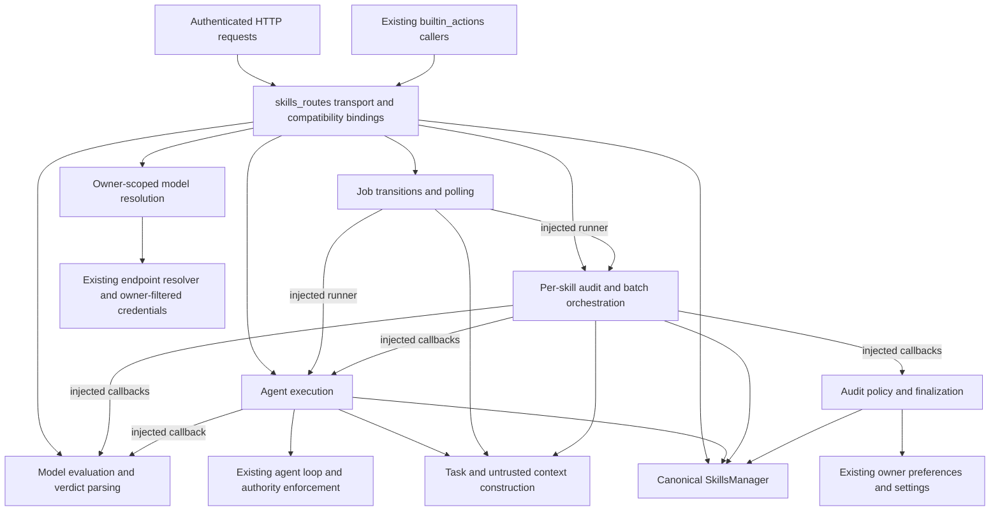

# Skills evaluation and audit boundaries

## Baseline and scope

Worktree: `architecture/skills-evaluation`; branch:
`refactor/skills-evaluation-boundary`; clean starting HEAD:
`86b886c611338282af6d4a717246ea4e256f58df`.
History contains #6683 (`afecd44d`), #6572 (`0e2c0830`), #6643
(`b5b76fe4`) and #6693 (`86b886c6`). Official public `dev` matched HEAD
when inspected on 2026-10-13. No commits, pushes or merges are authorized.

The installed skill catalog and filesystem contain no `orchestrate-work`
skill; the tool catalog exposes no Maestrum worker. Work proceeds locally.

## S0 responsibility map

The original route has 2,462 lines. `services/memory/skills.py` has 853
lines and remains the canonical persistence and lifecycle owner.

| Proposed module under `services/skill_audit` | Responsibility |
| --- | --- |
| `evaluation.py` | Run grading, verdict parsing, necessity, retrieval precision, model rewrites, efficiency fields |
| `execution.py` | Manual agent runs, audit arms, single retries, same-task stream closure |
| `orchestration.py` | Individual audits, sequential batches and scheduling |
| `jobs.py` | Job creation, continuation after validated approval, audit selection, polling projections and cancellation |
| `policy.py` | Approval threshold, duplicate guards, final status and batch finalization, applying edited markdown through SkillsManager |
| `models.py` | Existing owner-scoped audit worker and teacher resolution |
| `dependencies.py` | Explicit callable dependencies and transient job dictionaries |
| `routes/skills_routes.py` | HTTP validation, owner/admin checks, sealed approval consumption, compatibility bindings |

Policy calculations move together. Their existing differences remain:
the per-skill duplicate guard and batch connected-group finalizer have distinct
selection rules; storage retrieval uses its own established approval policy.
Unifying these rules would change behavior and is outside this extraction.

## Public HTTP contract

All paths below have prefix `/api/skills`. Successful status defaults to 200.
Request models and endpoint declaration order remain fixed. A frozen
OpenAPI and declaration-order fixture records
the baseline contract independently of the extracted implementation.

| Method and suffix | Successful response | Authorization and errors |
| --- | --- | --- |
| GET empty | `skills,count` | Owner-filtered load |
| GET `/index` | `index,count` | Owner-scoped eligible index |
| GET `/slash-catalog` | `skills,count` | Owner-scoped index; sorted slash entries |
| GET `/builtin` | `builtin,count` and optional `error` | Existing shared capability text |
| GET `/builtin/{name}` | `name,text,default,is_overridden` | 404 missing tool; 500 import failure |
| PUT `/builtin/{name}` | `ok,name,is_overridden` | Admin; 404 unknown, 400 missing text |
| DELETE `/builtin/{name}` | `ok,name,is_overridden` | Admin |
| POST `/import-from-url` | `ok,skill,files` | Admin and current owner; 400 import, 502 HTTP, 500 other failure |
| POST `/add` | `ok,deduped,skill` | Current owner passed to manager; unchanged old/new request fields |
| POST `/{skill_id}/invoke` | `ok,type,name,command,message` | Eligible owner index only; 404 unavailable/source missing |
| GET `/{skill_id}` | Full skill dictionary | Owner load; 404 missing |
| GET `/{skill_id}/markdown` | `name,markdown` | Owner verification; 404 missing/source missing |
| POST `/{skill_id}/test` | `ok,status,skill,model` | Owner verification, HTTP request authority, registered fallback credentials; 400 missing/invalid model |
| POST `/{skill_id}/test-approval` | `ok,status,decision` | User approval request, owner verification, pending ID/owner/empty session match; 400 invalid body/decision, 409 stale/mismatch/consumed |
| GET `/{skill_id}/test-status` | `status` or `status,task,model,log,verdict,approval` | Owner-keyed lookup; server continuation/credentials omitted |
| POST `/audit-all` | `ok,status,total` plus running `done,model` or empty `results,log` | Owner-keyed singleton; 400 model resolution |
| GET `/audit-all/status` | `status` or job progress/result/log/timestamps | Owner-keyed lookup; task and credentials omitted |
| POST `/audit-all/cancel` | `ok,status` | Owner-keyed lookup and cancellation |
| POST `/{skill_id}/markdown` | `ok,name` | Owner verification; 400 missing/parse, 404 missing, 500 update |
| PUT `/{skill_id}` | `ok` | Owner verification and scoped manager update; 404 missing |
| DELETE `/{skill_id}` | `ok` | Owner verification and scoped manager deletion; 404 missing |
| POST `/search` | `skills,query,count` | Owner-filtered input; 400 empty query |

Strict owner verification allows an ownerless builtin but denies an ownerless
ordinary skill for an authenticated user. The existing ownerless deployment
behavior remains. Global auth middleware is unchanged.

## Python compatibility and test seams

`app.py` imports `setup_skills_routes`. `src/builtin_actions.py` imports
`_run_skill_test_once`, `_skill_test_task`, `_resolve_audit_models`,
`_run_audit_all_job` and `_skill_audit_jobs`. Tests additionally import or patch
`_VERDICT_PROSE_RE`, `_skill_baseline_task`, `_run_skill_audit_arm`,
`_run_skill_test_job`, `_skill_test_jobs`, `_audit_one_skill`,
`_audit_auto_publish_policy`, `_audit_finalize_status`, `_audit_utility_blocker`,
`_finalize_audit_batch`, the evaluation helpers and `SkillAuditUnavailable`.
Retain all original top-level functions, classes, signatures and registries.
Bindings must pass patched collaborators explicitly; copying imports alone
would silently bypass these fixtures.

External dependency patches target `src.agent_loop.stream_agent_loop`,
`src.llm_core.llm_call_async/list_model_ids`, endpoint resolver functions,
`src.ai_interaction._resolve_model`, preferences and settings. Keep lazy
resolution and route-level effort injection so offline patches remain effective.

## Characterized lifecycle and security contracts

Manual tests replace owner/name jobs, deny replaced approvals, run detached
tasks, retain server-only continuation state on approval and poll condensed
logs. Manual results adjust confidence (pass .95, needs_work .6, fail .4)
without publishing. Audit arms suppress saved skill injection, use 4096 tokens,
and inherit active request authority or use empty owner authority. Manual
tests use the explicit originating authority or the sealed approval authority.
Both close async generators inside the originating task with `aclosing`.

Approval requests consume the exact ID destructively with
`allow_continuation=False`. Transcripts and skill markdown remain untrusted
context messages. Unattended audits deny encountered approvals and preserve
publication/confidence for approval-required results. No approval grants are
invented by a service boundary. Issue #6635 remains open: a manual test without
an appropriate workspace can still be unable to execute its proposed action.

Batches run sequentially per owner, record current/done/results, cap logs at
1,000, and finalize only on normal completion. Cancellation clears current/task
and skips finalization; infrastructure unavailability stops without a skill
verdict. Ordinary exceptions record an inconclusive result. Scheduled runs
select existing lifecycle candidates by oldest audit, cap the batch, skip
an active owner job and mark every model phase as background work.

Run review makes two attempts (32768 tokens, 180 seconds); necessity uses
8192/120, retrieval uses 4096/90, rewrites use 16384/180. Owner effort is
resolved for each model call. Preserve prompts, think stripping, trailing-comma
parsing, last verdict selection, bounded schema fields and unknown fallbacks.

Per-skill pass confidence is .95, self-edit pass .85, teacher rewrite pass .8;
continued failure becomes draft/.35. Inconclusive preserves publication.
Thresholds, automatic approval, redundancy and worse-baseline blockers remain.
Batch finalization touches only processed skills, protects approval-required
results, excludes builtins/binned records, and bins duplicate losers.
Published eligibility and remote-only exclusion remain in SkillsManager.

## Overlapping work

Read-only GitHub inspection found all of #6568, #6265, #6191, #6275 and #6695
open and unmerged. They concern model effort capability evidence, frontmatter
escaping, tool registry extraction, tool availability across turns and OXS.
Their changes are excluded. Recheck official `dev` before integration.

## Final architecture and inventory

The transport module delegates evaluation, execution, job transitions and audit
publication. Its original request classes, endpoint functions and declaration
order stay in place. Compatibility functions have their original signatures;
stateless helpers are aliases. At each service entry, `_audit_dependencies()`
binds current route symbols into a frozen, explicit collaborator record.
This preserves existing monkeypatches without changing service module globals
or importing `routes.skills_routes` from a service.

The test registry is owned by `execution.py`, and the audit registry by
`orchestration.py`. Routes expose aliases to those same dictionaries. Neither
registry is a second skill store: all durable updates use the supplied
SkillsManager. Polling deliberately projects only existing public fields.
HTTP handlers retain registered endpoint authorization and exact approval
validation; the service receives the consumed server-side grant.



Callbacks pass through compatibility wrappers where required by existing
callers and tests; arrows represent responsibility dependencies. The existing
preferences adapter still lives in `routes.prefs_routes`. Moving that unrelated
settings boundary is outside scope. No authority, sandbox, tool-execution,
provider, storage or frontend implementation changed.

| Production module | Original lines | Final lines |
| --- | ---: | ---: |
| `routes/skills_routes.py` | 2462 | 865 |
| `services/skill_audit/__init__.py` | 0 | 1 |
| `services/skill_audit/dependencies.py` | 0 | 32 |
| `services/skill_audit/evaluation.py` | 0 | 466 |
| `services/skill_audit/execution.py` | 0 | 312 |
| `services/skill_audit/jobs.py` | 0 | 219 |
| `services/skill_audit/models.py` | 0 | 77 |
| `services/skill_audit/orchestration.py` | 0 | 442 |
| `services/skill_audit/policy.py` | 0 | 351 |
| `services/skill_audit/prompts.py` | 0 | 54 |
| Extraction total | 2462 | 2819 |
| `services/memory/skills.py`, unchanged | 853 | 853 |

The route shrank by 1,597 lines (64.9%). Total code grows by 357 lines from
explicit dependency composition, compatibility bindings and module boundaries.
The purpose is separation of responsibilities, with no line-count quota.

Complete reviewable change inventory: the ten production paths above excluding
unchanged `services/memory/skills.py`, plus this document,
`tests/fixtures/skills_api_baseline.json`,
`tests/test_skills_audit_characterization.py`, and
`tests/test_skills_audit_services.py`. That is one modified file and thirteen
new files. Local verification also created ignored `.venv/`, `node_modules/`
and `.cache/` artifacts, which are not integration deliverables.

## Compatibility and security verification

The baseline fixture freezes all 22 endpoint declarations, all 28 inspectable
original Python signatures, and the whole generated OpenAPI digest:
`7abc5b334a6c3c52dd3eba15d8bc516da728a67f14fb7f56d0bb5992d89a16ca`.
The exception class remains available at its original import path as an alias.
The fixture was captured before structural extraction. No request models,
endpoint docstrings, operation IDs or response declarations changed.

A read-only AST comparison against `git show HEAD:routes/skills_routes.py`
verified 20 moved function bodies, the extracted verdict parser, and four
model system prompts. Comparison normalized only injected collaborator names
and excluded docstrings; it did not normalize branching, thresholds, request
arguments, stream cleanup or exception handling. The evaluation parser's
imports and verdict tuple moved with it. Full runtime checks supplement this
structural evidence.

A second AST comparison verified all 19 unchanged route handlers/helpers and
the approval handler's validation and sealed-consumption prefix. The only
removed import in that prefix was `asyncio`, now used by the job service.

| Required contract | Evidence |
| --- | --- |
| Route and Python compatibility | Frozen declaration order, OpenAPI digest, signatures and existing route tests |
| Owner isolation | Existing manager/update/delete, request-authority, registered-endpoint and teacher-owner tests; live second-owner 404 |
| Utility effort and fallback | Existing utility reasoning tests; advisory owner tests; first owner-scoped audit fallback and served-model normalization |
| Verdict parsing and failure schemas | Characterization cases for think blocks, trailing commas, last verdict, coercion, prose, retry and transient exceptions |
| Scheduling and progress | Existing scheduled/background phase tests; batch done/results/current/timestamps and ordinary exception case |
| Finalization and publication | Threshold/auto-approval matrix, inconclusive preservation, duplicate winners/losers, unprocessed and approval-required protection |
| Cancellation and cleanup | Cancellation in the originating context, skipped batch finalization, cleared task/current and stream exception cleanup |
| Approved and rejected execution | Existing exact ungranted-process and authority tests; route grant/deny integration tests |
| Exact approval reuse prevention | Destructive store consumption, single-action grant flags and second submission returning 409 |
| Published and remote-only eligibility | Existing index/retrieval and lifecycle suites; SkillsManager implementation unchanged |
| Skills UI/API integration | Existing Skills UI/static tests, Node approval metrics tests, live authenticated API and asset checks |

The security review found no widened authority source. The manual runner uses
the original request or sealed pending authority and otherwise empty owner
authority. Audit arms retain active task-local authority, saved-skill
suppression and same-task `aclosing`. Both approval ID and normalized owner
must match, and the session must be empty. Internal tool approval requests are
still rejected before consumption. Continuations keep skill/transcript bytes
tainted. Unattended approvals are denied rather than retained as reusable
grants. Services do not reconstruct sealed operations or choose a workspace.

## Validation record

All Python runs used the worktree-local CPython 3.11 environment and the
declared `requirements-dev.txt`. The shell's original `python` belonged to an
unrelated project and lacked pytest; no changes were made to that environment.
The first fixture-generation attempt tried to inspect the exception class,
which has no Python signature. After limiting the signature inventory to
inspectable symbols, the complete baseline passed. No assertion was weakened.

The checkpoint command groups below are literal pytest arguments:

```text
S0:
tests/test_skills_audit_characterization.py tests/test_skill_audit_utility.py
tests/test_skill_audit_unavailable.py tests/test_skill_test_stream_closed.py
tests/test_skills_routes_owner_update.py tests/test_skills_routes_nondict.py
tests/test_skills_delete_owner.py tests/test_skill_save_no_rename.py
tests/test_skills_manager_owner_isolation.py tests/test_skill_lifecycle.py
tests/test_skill_index_local_model_gating.py tests/test_utility_reasoning_effort.py
tests/test_teacher_audit_owner_scope.py tests/test_review_endpoint_credentials.py
tests/test_request_authority.py tests/test_endpoint_registered_authority.py
tests/test_exact_approval_ungranted_process.py tests/test_tool_approvals.py
tests/test_tool_approval_single_action_scope.py tests/test_tool_approval_task_scope.py

S1:
tests/test_skills_audit_characterization.py tests/test_skill_audit_utility.py
tests/test_utility_reasoning_effort.py tests/test_redos_verdict_continuation.py
tests/test_redos_residual_python.py

S2:
tests/test_skills_audit_characterization.py tests/test_skill_test_stream_closed.py
tests/test_skills_routes_nondict.py tests/test_skills_routes_owner_update.py
tests/test_skill_audit_unavailable.py tests/test_skill_audit_utility.py
tests/test_teacher_audit_owner_scope.py tests/test_review_endpoint_credentials.py
tests/test_request_authority.py tests/test_endpoint_registered_authority.py
tests/test_tool_approval_single_action_scope.py

S3:
tests/test_skills_audit_characterization.py tests/test_skill_audit_utility.py
tests/test_skills_manager_owner_isolation.py tests/test_skill_lifecycle.py
tests/test_skill_save_no_rename.py tests/test_skill_index_local_model_gating.py

S4:
tests/test_skills_audit_characterization.py tests/test_skills_routes_owner_update.py
tests/test_skills_routes_nondict.py tests/test_skill_audit_utility.py
tests/test_skill_audit_unavailable.py tests/test_skill_test_stream_closed.py
tests/test_request_authority.py tests/test_endpoint_registered_authority.py
tests/test_tool_approval_single_action_scope.py
```

| Run | Command | Result |
| --- | --- | --- |
| S0 | `.venv/bin/python -m pytest -q` with S0 arguments | 447 passed, 2 warnings, 18.63 seconds |
| S1 after parser extraction | Same command with S1 arguments | 133 passed, 1 warning, 1.47 seconds |
| S2 | Same command with S2 arguments | 374 passed, 2 warnings, 17.31 seconds |
| S3 | Same command with S3 arguments | 48 passed, 1 warning, .94 seconds |
| S4 | Same command with S4 arguments | 356 passed, 2 warnings, 16.21 seconds |
| Added service/HTTP contracts | `.venv/bin/python -m pytest -q tests/test_skills_audit_services.py tests/test_skills_audit_characterization.py` | 39 passed, 1 warning, .70 seconds |
| Added duplicate finalization cases | `.venv/bin/python -m pytest -q tests/test_skills_audit_services.py` | 22 passed, 1 warning, .65 seconds |
| Initial full relevant selection | `.venv/bin/python -m pytest -q -rs --durations=15` with the 53-file selection below | 726 passed, 2 warnings, 21.65 seconds |
| Final full relevant selection, including fallback and duplicate cases | Same command with the 53-file selection below | 729 passed, 2 warnings, 22.88 seconds |
| Repository-wide CI-equivalent Python scope | `env -u APP_PORT PATH="$PWD/.venv/bin:$PATH" PLAYWRIGHT_BROWSERS_PATH="$PWD/.cache/ms-playwright" .venv/bin/python -m pytest -q -rs --durations=25` | 13959 passed, 3 failed, 60 skipped, 6 warnings, 6 subtests passed, 605.00 seconds |

The reproducible relevant-file selection used for the final run is:

```python
from pathlib import Path
import subprocess
import sys

files = set()
for path in Path("tests").rglob("test_*.py"):
    text = path.read_text()
    if ("skill" in path.name or "approval" in path.name
        or "utility_reasoning" in path.name or "skills_routes" in text
        or "review_endpoint_credentials" in path.name):
        files.add(str(path))
files.update([
    "tests/test_request_authority.py",
    "tests/test_endpoint_registered_authority.py",
    "tests/test_redos_verdict_continuation.py",
    "tests/test_redos_residual_python.py",
])
subprocess.run([sys.executable, "-m", "pytest", "-q", "-rs",
                "--durations=15", *sorted(files)], check=True)
```

Other executed validation:

- `.venv/bin/python -m compileall -q app.py core routes src services scripts tests`: passed.
- `.venv/bin/python scripts/build_frontend.py --check`: passed, zero changed modules.
- `node scripts/check_frontend.mjs`: passed.
- `node --test tests/skillsApproval.test.mjs tests/frontendArchitecture.test.mjs`: 13 passed.
- `node --check` for `static/app.js`, `scripts/check_frontend.mjs`, all `static/js/**/*.js` and `frontend/src/**/*.js`: 235 files passed.
- `git diff --check`: passed.
- `bwrap --die-with-parent --unshare-pid --ro-bind / / --proc /proc --dev /dev /bin/true`: passed.
- `.venv/bin/python .cache/skills-runtime-smoke.py`: 17 live HTTP checks passed against an isolated uvicorn process.

Python was 3.11.17 and Node was 22.23.1. CI's Python version matches; its Node
version is 20, so the local Node checks are equivalent commands with a newer
runtime. Existing SQLAlchemy and Pydantic deprecation warnings remain.

The repository-wide run completed with failures in these unchanged tests:

```text
tests/test_agent_tmux_retirement.py::test_legacy_cleanup_against_a_private_real_tmux_server
tests/test_containment_enforcement.py::test_namespace_handshake_closes_model_stdin
tests/test_containment_enforcement.py::test_execution_environment_cannot_replace_probed_bwrap[False]
```

The tmux test reported `{seen: 1, torn_down: 0, unverifiable: 1, failed: 0}`.
Both containment tests completed their expected command but included three
extra stderr lines: `Failed to create stream fd: No such file or directory`.
Their exact-output assertions failed. No containment implementation or
assertion was modified to suppress this output.

The exact targeted rerun command was:

```sh
env -u APP_PORT PATH="$PWD/.venv/bin:$PATH" .venv/bin/python -m pytest -q -rs \
  tests/test_agent_tmux_retirement.py::test_legacy_cleanup_against_a_private_real_tmux_server \
  tests/test_containment_enforcement.py::test_namespace_handshake_closes_model_stdin \
  'tests/test_containment_enforcement.py::test_execution_environment_cannot_replace_probed_bwrap[False]'
```

Current-worktree rerun: 2 failed, 1 passed, 1 warning, 2.69 seconds.
A fresh `git archive HEAD` snapshot, unpacked into an owned temporary directory
under this worktree's `.cache/`, ran the same three nodes with the same Python
environment: 2 failed, 1 passed, 1 warning, 2.82 seconds. Both containment
failures reproduced against the unchanged required baseline with the same
stderr output. The tmux case passed in both isolated reruns; its full-suite
failure remains intermittent or dependent on test order/environment and is
not fully diagnosed. The snapshot was removed after collecting evidence.
The full-suite check is therefore not green. Official CI should verify these
host-dependent process cases before integration.

Sixty existing skips cover unconfigured live application/Ajax smoke tests,
an allowlisted browser release image, absent optional tools/dependencies and
platform-specific cases. The final relevant run includes the three new
duplicate/fallback cases added after repository-wide test collection.
Full output is retained locally in `.cache/skills-full-pytest.log`,
`.cache/skills-failure-recheck.log` and
`.cache/skills-baseline-failure-recheck.log`.

The application smoke script started real uvicorn on an owned ephemeral
loopback socket with authentication enabled. Its temporary data directory,
database, caches and sockets were inside this worktree. Chroma pointed at
unavailable port 0; pollers, scheduler and embedding prewarm were disabled
through existing deployment settings. Seventeen HTTP checks passed: health,
setup/login, Skills list/index/slash catalog, draft creation, markdown, manual
test and audit missing-model 400 responses, test polling, cancellation, memory
page, Skills JavaScript, second account/login, and cross-owner markdown 404.
The server completed shutdown and its private runtime directory was removed.
No live model execution or production skill state was used.

## Integration recommendation and limitations

Recommend one backend extraction PR with its characterization fixture, tests
and architecture document. Separating evaluation from execution into multiple
integration PRs would introduce intermediate compatibility wiring without
reducing the security review required for the final result. S0 through S4 are
engineering checkpoints, not proposed separate PRs. The maintainer retains
the decision. No commit, push, issue creation, PR creation or merge occurred.

Any eventual public PR must target official `dev`, use
`.github/pull_request_template.md` and link a dedicated architecture issue.
It must report the actual isolated runtime validation and distinguish it from
live model testing. Issue #6635 remains unresolved and must not be closed by
this extraction.

Read-only official `dev` checks at the start and after implementation both
returned `86b886c611338282af6d4a717246ea4e256f58df`. There are no newly merged
upstream conflicts at the inspected revision. The five overlapping open PRs
remain excluded; their model, parser, registry, agent and extension work should
be reviewed independently when integrating future upstream changes.

Existing limitations remain: jobs are transient across restarts, manual tests
without an appropriate workspace can fail execution, and advisory model
outputs retain their original permissive coercions and unknown fallbacks.
This work adds no workspace workaround or new security policy. The isolated
smoke did not exercise a configured live model or a real external tool action.
Offline stream/approval tests and existing sealed-process tests cover those
boundaries deterministically.
